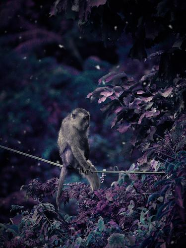
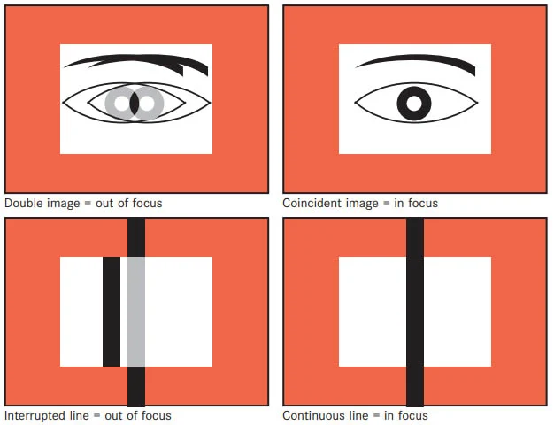
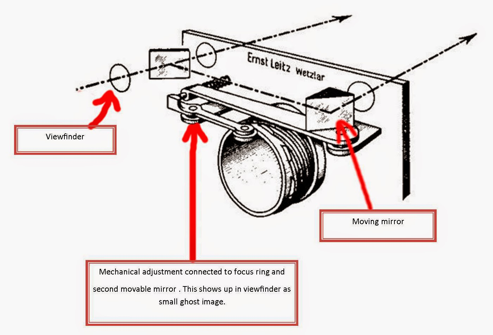
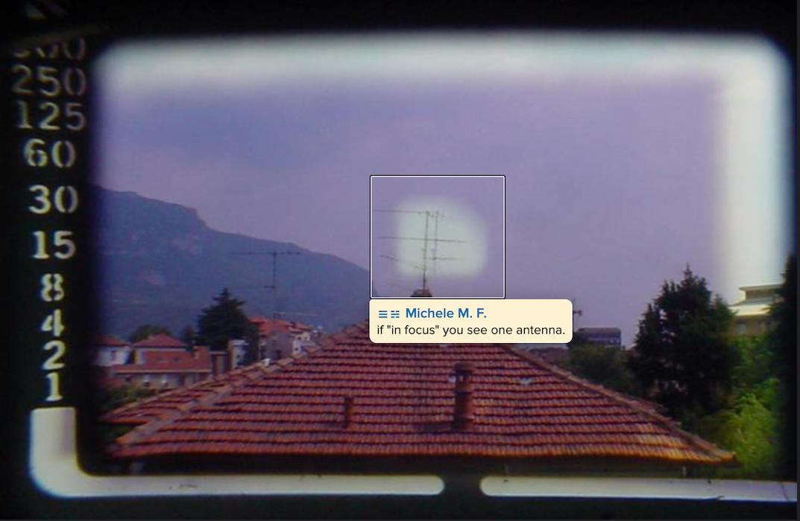
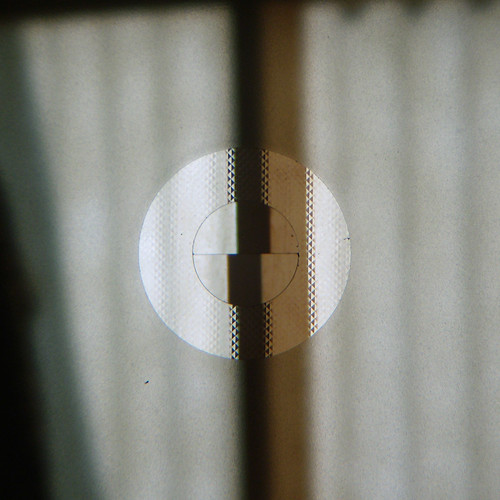
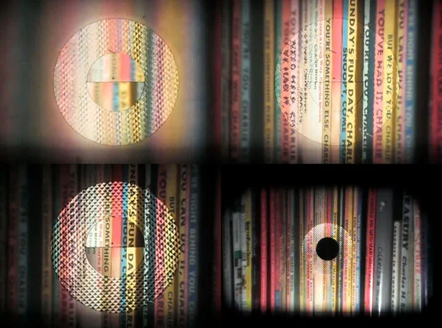
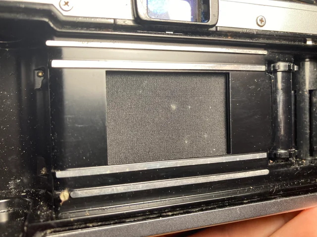
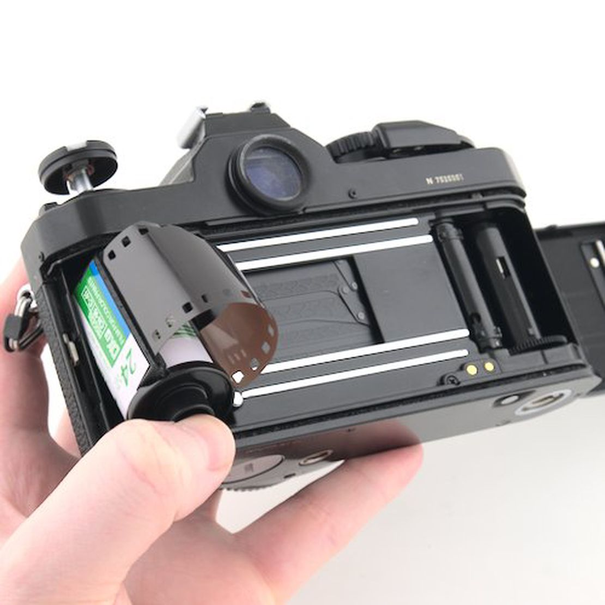
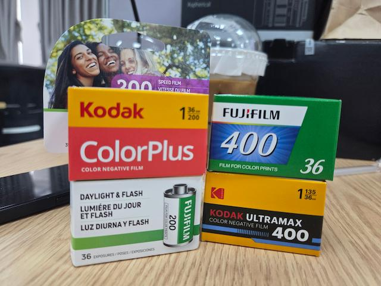
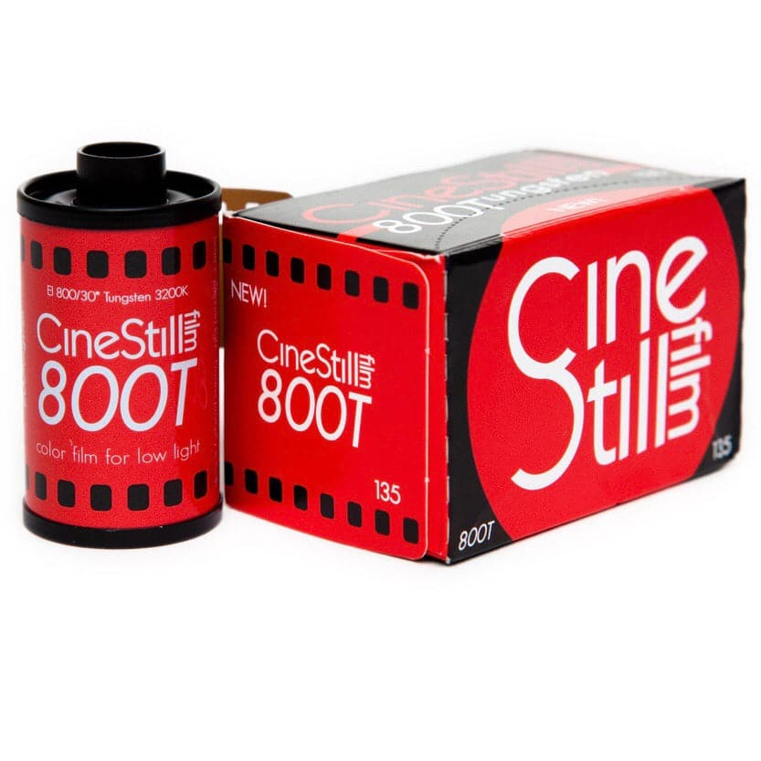

## Chiếc máy phim đầu tiên (tự mua)

Một ngày đẹp trời, mình xem clip của [Justin Vo](https://youtu.be/rwiEKPCXqaw?si=mjs-f399mATYDdpA) hướng dẫn chỉnh màu giả lập phim bằng [Dehancer Desktop](https://www.dehancer.com/shop/desktop). Tải về vọc thử, mình mê luôn cuộn [Lomography Lomochrome Purple XR](https://www.analog.cafe/r/lomography-lomochrome-purple-xr-film-review-hw0y). Cuộn này chụp được từ ISO 100 tới 400, mỗi mức lại cho màu khác nhau khá nhiều, mà mình chỉnh hoài vẫn thấy sai sai. Giả lập mãi không ra thì thôi, mua máy chụp thật luôn.

Sau mấy ngày lượn YouTube, mình đặt ra ba tiêu chí: chỉnh tay hoàn toàn, có đo sáng, giá rẻ. Thêm mấy ngày lượn chợ Facebook với Shopee, mình chốt được một chiếc [Canon Canonet QL17 GII](https://global.canon/en/c-museum/product/film74.html). Cách chọn cũng đơn giản: thấy máy nào giá hợp lý thì lên mạng kiểm tra thông tin, ổn thì mua.

Mua xong mới thấy mình tìm hiểu chưa tới nơi. Phần dưới là mấy chỗ mình tưởng đã hiểu, mà thật ra hiểu sai.

## Đóng tiền học phí

### "Bộ tứ huyền thoại" là chuyện của Việt Nam

Lúc tìm hiểu [Canon Canonet QL17 GIII](https://www.youtube.com/watch?v=CPBoclyLB94) trên kênh của [Kiệt Nguyễn](https://www.youtube.com/@kietnguyen), mình biết tới khái niệm bốn chiếc máy phim huyền thoại:

- [Canon Canonet QL17 GIII](https://global.canon/en/c-museum/product/film84.html)
- [Yashica Electro 35 GX](https://camera-wiki.org/wiki/Yashica_Electro_35_GX)
- [Olympus 35 RD](https://www.brokencamera.club/blog/2017/1/25/olympus-35-rd)
- [Minolta Hi-matic 7sII](https://casualphotophile.com/2017/05/24/minolta-hi-matic-7sii-35mm-film-rangefinder-camera-review/)

Cả bốn đều là máy rangefinder nhỏ gọn, ống kính cố định `40mm f/1.7`. Lên chợ Facebook thì thấy ai cũng nhắc tới bộ tứ này, kể cả chỗ mình mua máy, nên mình tin nó là chuẩn mực.

Rồi sau một buổi tập lấy nét trên Canonet, mình bắt đầu thắc mắc: lấy nét cực vậy mà sao thành huyền thoại được? Mất thêm một ngày đi tìm máy khác lấy nét dễ hơn, mình mới phát hiện khái niệm "bộ tứ" chủ yếu phổ biến trong cộng đồng Việt Nam. Tìm trên các trang nước ngoài thì gần như không thấy ai gọi như vậy.

Còn cái "cực" khi lấy nét thì nằm ở chính chữ rangefinder, và đó là chỗ thứ hai mình hiểu sai.

### Rangefinder không phải là một kiểu dáng

Ban đầu mình nghĩ `rangefinder` là kiểu máy có ống ngắm lệch qua một bên, tiêu biểu là [Fujifilm X100 series](https://www.fujifilm-x.com/global/products/cameras/x100vi/). Thật ra cái tên này đến từ cơ chế lấy nét.

Hình trên minh họa cơ chế `coupled optical rangefinder`. Nhìn qua ống ngắm (viewfinder), ta thấy hai hình ảnh của cùng một chủ thể: hình chính đi vào từ cửa sổ ngắm, hình phụ được thu qua một cửa sổ khác rồi phản xạ vào hệ thống quang học bên trong máy. Khi xoay vòng lấy nét, hình phụ dịch chuyển theo. Lúc hai hình trùng khít với nhau cũng là lúc ống kính đã lấy nét đúng khoảng cách tới chủ thể.

Vì vậy, `Fujifilm X100 series` không phải máy rangefinder. Nó có kiểu dáng gợi nhớ tới rangefinder, nhưng không có cơ chế quang học tạo ra hai hình ảnh để canh nét.

### Lấy nét điểm vàng không phải cách duy nhất

Máy ảnh thời kỳ đầu cho người dùng nhìn hình trên một tấm kính mờ, gọi là `ground glass`, nơi ống kính chiếu hình trực tiếp lên. Người chụp vặn vòng lấy nét cho tới khi hình trên kính mờ sắc nét.

Về sau, mỗi dòng máy có cách riêng để việc canh nét dễ hơn. Máy rangefinder dùng [coincidence rangefinder](https://en.wikipedia.org/wiki/Coincidence_rangefinder). Máy SLR vẫn nhìn hình qua ống kính trên màn lấy nét, nhưng thêm [split-image](https://camera-wiki.org/wiki/Split_prism) hoặc [microprism](https://camera-wiki.org/wiki/Microprism) ở giữa.

#### Coincidence rangefinder

Ở Việt Nam hay gọi là `lấy nét điểm vàng`. Giữa khung ngắm có một ô màu vàng, gọi là `rangefinder patch`, và hình phụ chỉ hiện trong ô này. Người chụp xoay vòng lấy nét cho tới khi hình trong ô vàng trùng với hình chính.

Lớp màu vàng của `rangefinder patch` có thể phai theo thời gian, làm hình phụ khó nhìn hơn. Khắc phục được, nhưng phục hồi thường khá phức tạp. Chỗ thiếu sáng thì hai hình cũng khó canh hơn hẳn.

#### Split-image

Cái này gọi là `lấy nét cắt` hay `lấy nét hoa dâu`. Khi chưa nét, vòng tròn ở giữa bị cắt làm hai nửa lệch nhau. Xoay vòng lấy nét tới khi hai nửa khớp lại là xong.

Khác với rangefinder, người chụp vẫn thấy hình đi qua ống kính trên toàn bộ màn lấy nét, còn vùng `split-image` chỉ dùng để canh điểm nét. Nhược điểm là nó cần chủ thể có đường nét hoặc cạnh rõ. Nếu đường nét song song với đường cắt của vòng tròn thì rất khó thấy độ lệch; lúc đó xoay nhẹ máy một chút là dễ nhìn hơn.

#### Microprism

Vùng `microprism` không cắt hình làm hai. Khi chưa nét, hình trong vùng này nhấp nháy hoặc vỡ thành nhiều mảng nhỏ. Xoay tới đúng điểm nét thì hình hết vỡ và rõ trở lại.

Có máy chỉ dùng `microprism`, có máy kết hợp `split-image` ở giữa và một vòng `microprism` bao quanh, như màn lấy nét của [Nikon FM](https://imaging.nikon.com/imaging/information/chronicle/cousins09-e/).

### Màn trập vải không phải đồ đời cũ

Mình biết tới chuyện màn trập khi đọc về [những lỗi hay gặp trên Olympus OM-1](https://www.reddit.com/r/AnalogCommunity/comments/1ixqw13/problem_with_olympus_om1/). Lúc đầu mình nghĩ màn trập vải là công nghệ cũ, còn màn trập kim loại là bản nâng cấp. Đọc thêm mới thấy không hẳn vậy.

#### Màn trập vải

Màn trập vải dùng hai rèm làm bằng vải chuyên dụng, bề mặt thường màu đen để chặn sáng. Khi bấm máy, hai rèm lần lượt chạy qua trước mặt phẳng phim, chừa ra một khe hở cho ánh sáng đi vào. Tốc độ càng nhanh thì khe hở giữa hai rèm càng hẹp.

Rèm vải nhẹ nên chạy êm. Tiếng bấm máy chỉ là một tiếng "tách" nhỏ, người xung quanh gần như không để ý, nên rất hợp chụp street. Đổi lại, vải sợ nắng: để máy mở nắp ống kính chĩa thẳng vào mặt trời, ống kính gom sáng như kính lúp và có thể đốt thủng rèm. Rèm vải cũng khó chạy nhanh, nên phần lớn máy dừng ở tốc độ `1/1000s`, đồng bộ flash chỉ khoảng `1/50s` tới `1/60s`.

#### Màn trập kim loại

Màn trập kim loại vẫn làm đúng việc đó: hai rèm chạy qua mặt phẳng phim để kiểm soát ánh sáng. Nhưng lá kim loại cứng và không sợ nắng, nên chạy nhanh hơn nhiều. Nikon FM2 chẳng hạn, lên tới `1/4000s` và đồng bộ flash `1/200s`. Cái giá là tiếng bấm máy to và khô hơn, chụp chỗ đông người dễ bị chú ý. Lá kim loại cũng rất mỏng, lỡ tay chạm vào khi mở nắp sau là có thể làm cong lá.

Vậy nên chọn loại nào là tùy cách chụp. Chụp street, cần máy êm để không ai giật mình quay lại, thì rèm vải dễ chịu hơn. Chụp nắng gắt, cần tốc độ cao hoặc hay dùng flash, thì rèm kim loại có lợi hơn. Leica tới giờ vẫn giữ màn trập vải cho các máy M chụp phim đang bán như Leica MP, M-A hay bản M6 làm lại năm 2022, dù các máy M kỹ thuật số của chính Leica đã chuyển sang màn trập kim loại từ lâu.

### Số trên hộp phim không phải lúc nào cũng là số để set máy

#### ISO trên hộp phim

Mới nhập môn, ai cũng được dặn: nhìn số `ISO`/`ASA` trên hộp phim rồi set máy y như vậy. Phần lớn trường hợp, cách này đúng. [Kodak Portra 400](https://www.analog.cafe/r/kodak-portra-400-film-review-teli) hay [Fujifilm Superia Premium 400](https://www.analog.cafe/r/fujifilm-superia-premium-400-film-review-zl9n) thì cứ set ISO 400.

Nhưng [ORWO Wolfen NC 500](https://www.analog.cafe/r/orwo-wolfen-nc-500-film-review-and-exposure-guide-7y1k) thì khác. Nhìn tên, mình nghĩ ngay đây là phim ISO 500. Trên hộp lại ghi khuyến nghị ISO 400. Đọc trải nghiệm của người đã chụp qua thì thấy khá nhiều người khuyên chụp ở ISO 200.

Lý do là ở ISO 400, ảnh hơi tối so với cách nhiều người muốn khai thác cuộn này. Set máy ở ISO 200 thì máy đo sáng cho phim nhận dư khoảng 1 stop. Tráng theo quy trình bình thường, ảnh ra sẽ sáng hơn.

Không chỉ sáng hơn. Phim âm bản chịu dư sáng rất tốt, nên chụp thấp hơn số trên hộp khoảng nửa tới 1 stop thì màu thường lên đậm và tươi hơn, vùng tối sạch hơn, hạt cũng mịn hơn. Ngược lại, thiếu sáng là màu bệt và đục, vùng tối lổn nhổn hạt. Vì vậy nhiều người chụp Portra 400 ở ISO 200 hay 320 cho chắc. Dư quá nhiều thì màu lại nhạt dần sang kiểu pastel, nên cũng đừng hạ quá tay.

Mẹo này chỉ đúng với phim âm bản (C-41). Phim dương bản (slide) thì ngược lại: dư sáng là màu bạc ngay, nên phải chụp đúng số trên hộp, thậm chí có người còn chụp thiếu một chút để màu đậm hơn.

#### Chữ "D" và "T" sau số ISO

Chọn phim kiểu gì cũng sẽ gặp [Cinestill 800T](https://cinestillfilm.com/products/800tungsten-c41-36exp-35mm-high-speed-color-negative-135). Số `800` là độ nhạy sáng, giống phần trên. Còn chữ `T` là `Tungsten`: cuộn phim được cân bằng màu cho ánh sáng đèn tungsten, khoảng 3200K.

Hai thứ này nói về hai chuyện khác nhau. Một bên là phim nhạy sáng tới đâu, bên kia là phim được làm cho loại ánh sáng nào. Chụp `800T` dưới nắng, vốn có nhiệt độ màu cao hơn đèn tungsten, ảnh sẽ ám xanh nếu không gắn kính lọc chuyển màu phù hợp.

Ngược lại, chữ `D` là `Daylight`, như [Cinestill 50D](https://cinestillfilm.com/products/50daylight-36exp-135-fine-grain-color-film-35mm-roll): phim được cân bằng màu cho ánh sáng ban ngày.

## Học phí đáng tiền

Chiếc Canonet không ở với mình lâu. Sau này mình đổi qua Nikon S2, rồi lại sa vào lịch sử rangefinder của Nikon ở bài [Một bước nhỏ](/hobbies/mot-buoc-nho). Có điều, lần mua máy sau, mình đọc kỹ hơn nhiều.

## Tham khảo

- Dmitri, [Lomography Lomochrome Purple XR Film Review: A Unique, False-Colour Experimental Film With an “Extended” Dynamic Range](https://www.analog.cafe/r/lomography-lomochrome-purple-xr-film-review-hw0y), Analog Cafe.
- TinhTang, [Bộ tứ lừng danh Rangefinder 40mm 1.7](http://www.vnphoto.net/forums/showthread.php?t=32369), VNPhoto.
- Daniel O'Neil, [What is a Rangefinder Camera?](https://petapixel.com/what-is-a-rangefinder-camera), PetaPixel.
- Paul Hemming, [A quick guide to camera focusing systems : Rangefinders](https://thebigworldpicture.blogspot.com/2014/04/a-quick-guide-to-camera-focusing.html), The Big World Picture.
