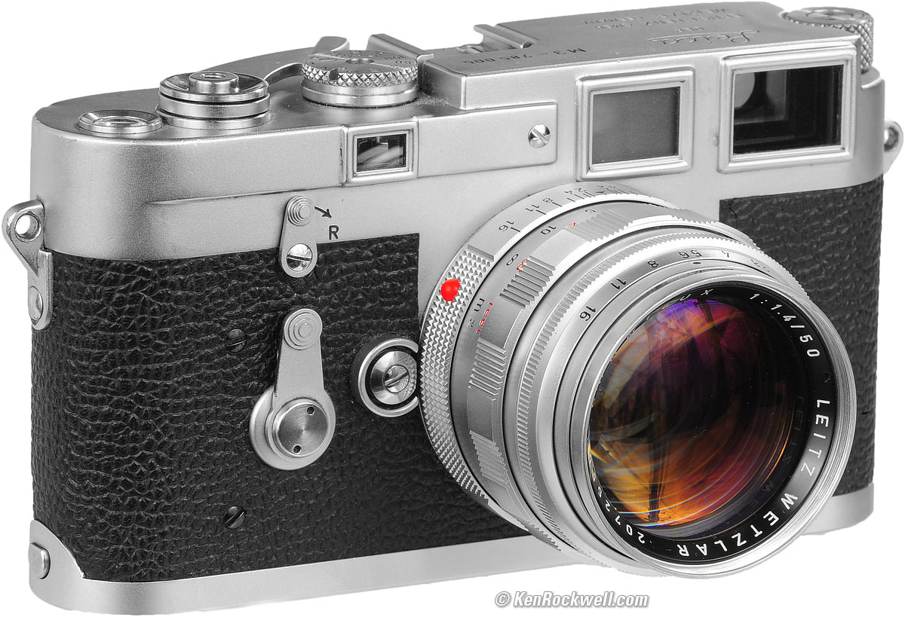
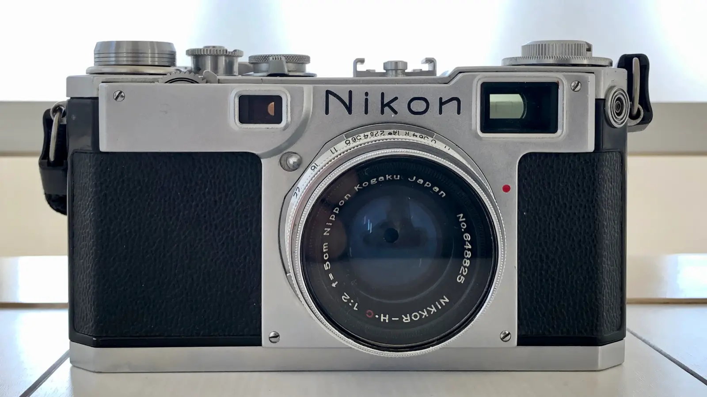
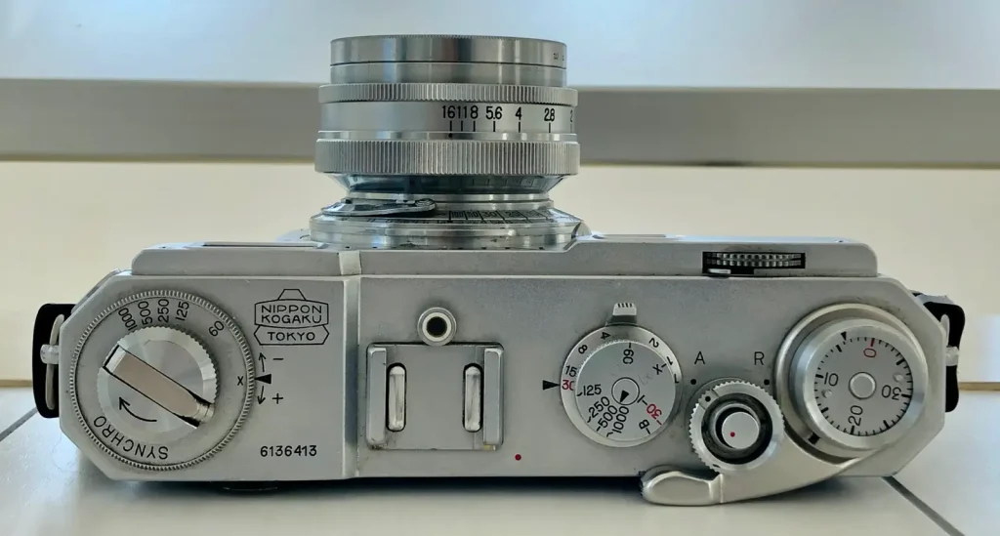
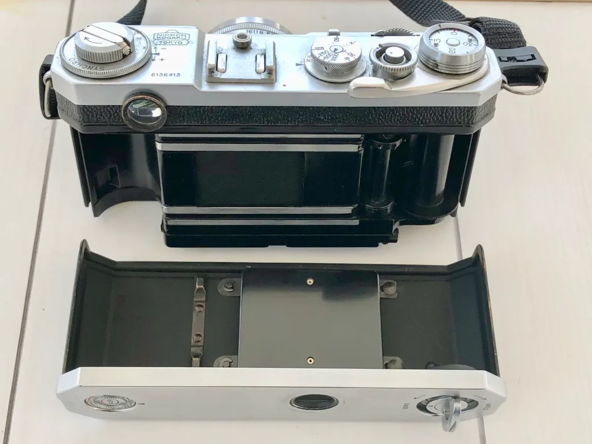
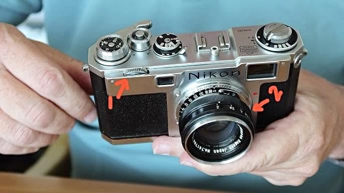
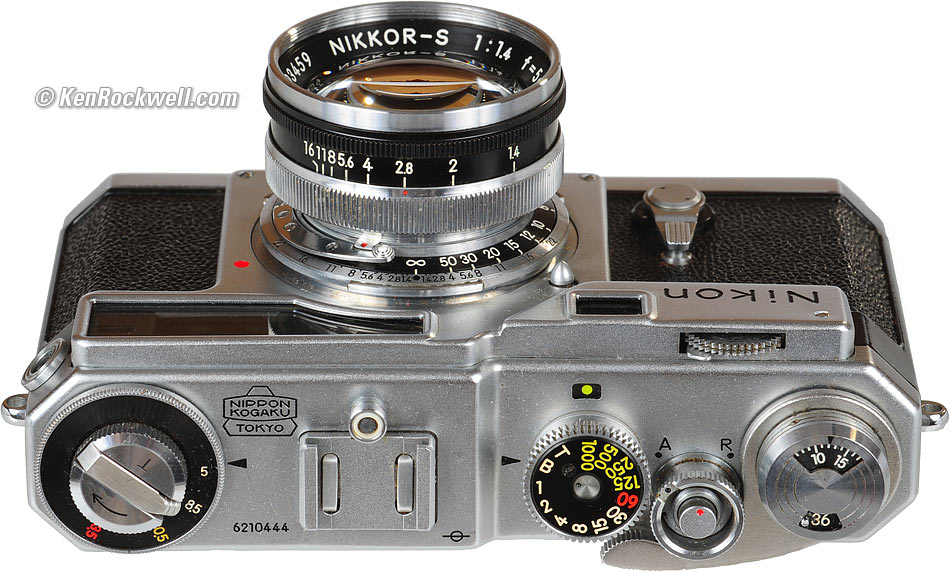
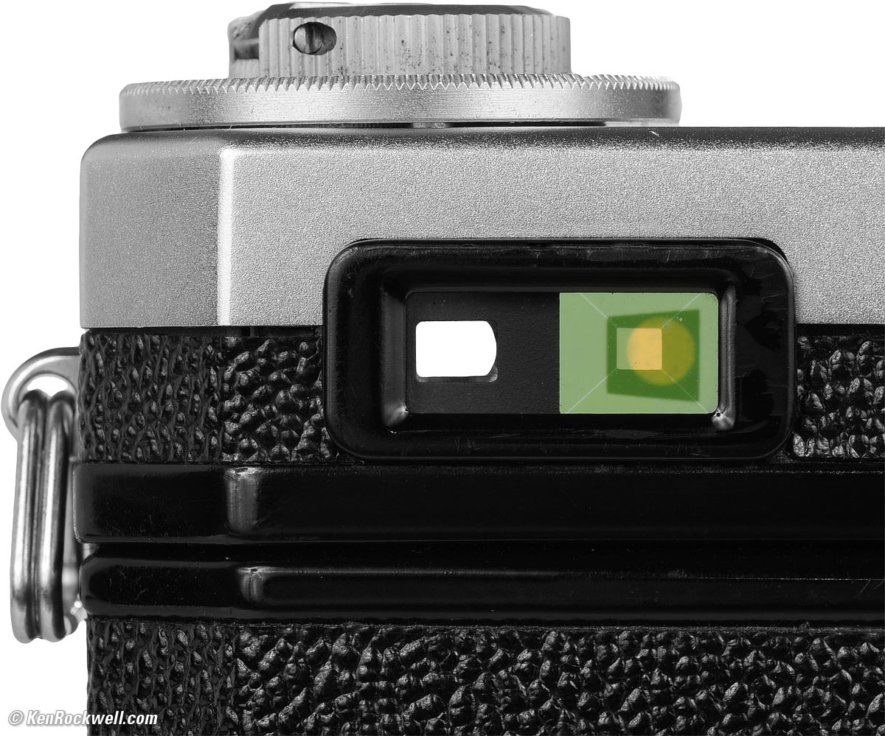
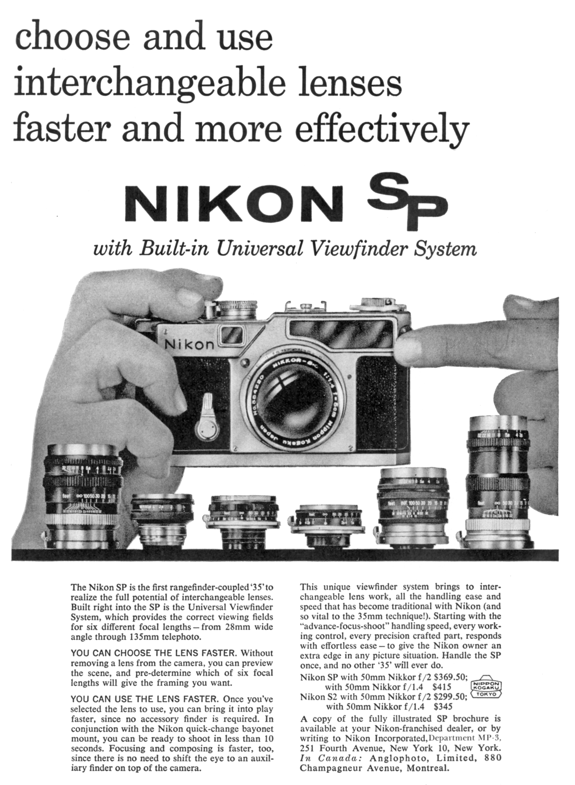
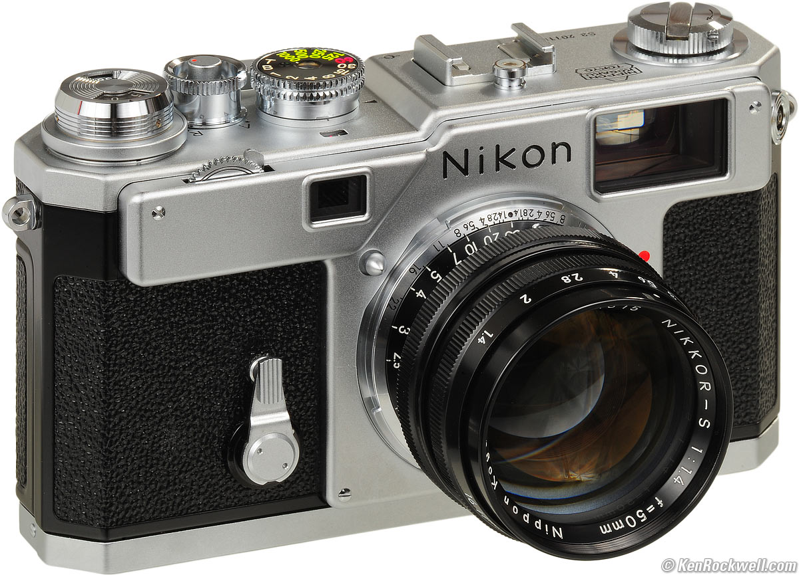
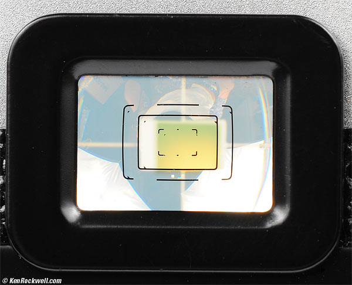

Lần trước mình có mua [Canon Canonet QL17 GII](/hobbies/chi-dinh-thu-vai-cuon-phim), nhưng vì nhiều lý do nên mình đổi qua [Nikon S2](https://imaging.nikon.com/imaging/information/chronicle/rhnc08s2-e/). Càng tìm hiểu, mình càng thấy phần thú vị không nằm ở bản thân chiếc máy, mà ở cách Nikon đi qua giai đoạn rangefinder: ba chiếc máy, ba lựa chọn khác nhau.

- **Nikon S2** — biết dừng. Leica M3 ra mắt khi S2 đã gần xong. Nikon không chạy theo, chỉ sửa những gì còn kịp sửa rồi đưa máy ra thị trường.
- **Nikon SP** — biết cải thiện. Khi nền móng đã đủ vững, Nikon dồn gần như mọi thứ mình có vào một chiếc máy.
- **Nikon S3** — biết giới hạn. Cắt bớt tham vọng của SP để chiếc máy đến được với nhiều người hơn.

Nhưng trước hết, phải nói về chiếc máy đã khiến cả ngành phải nhìn lại mình.

## Khi Leica mở ra một kỷ nguyên mới

Bước vào thập niên 1950, nước Đức vẫn là trung tâm của ngành công nghiệp máy ảnh. `Leica` của [Ernst Leitz](https://leica-camera.com/en-US/press/four-generations-leitz-company-management-1869-1986) và `Contax` của [Zeiss Ikon](https://lenspire.zeiss.com/photo/en/article/a-compendium-of-the-history-of-zeiss-cameras) đã định hình phần lớn cuộc chơi rangefinder **35mm** trong nhiều thập kỷ. Ngành máy ảnh Nhật Bản khi đó vẫn đang tìm bản sắc riêng, và Nikon hay Canon đều chịu ảnh hưởng rõ từ các thiết kế Đức.

Tháng 4/1954, tại Photokina ở Cologne, Leica cho ra mắt [Leica M3](https://www.kenrockwell.com/leica/m3.htm).

So với các máy Leica screw-mount trước đó như [Leica IIIf](https://www.kenrockwell.com/leica/screw-mount/iiif.htm), M3 gần như được thiết kế lại từ đầu. Có ba thay đổi sẽ còn quay lại nhiều lần trong bài này:

- Kính ngắm và rangefinder được gộp vào một khung ngắm lớn, sáng, có sẵn frameline cho các tiêu cự **50mm**, **90mm** và **135mm**.
- Toàn bộ tốc độ màn trập nằm trên cùng một núm chỉnh, thay vì tách riêng tốc độ nhanh và chậm.
- Bộ đếm khung hình tự reset khi mở buồng phim, và lên phim bằng cần gạt thay cho núm xoay.

Thêm vào đó là ngàm M dạng **bayonet** thay cho ngàm **screw mount M39**, đặt nền móng cho cả hệ thống Leica M sau này.

Vậy đúng lúc Leica mở ra một thế hệ rangefinder mới, Nikon đang đứng ở đâu?

## Nikon và lựa chọn dừng lại

Canon những năm đầu đi khá gần với con đường của [Leica](https://global.canon/en/c-museum/history/story01.html), còn Nikon lại chọn học hỏi nhiều hơn từ [Contax](https://imaging.nikon.com/imaging/information/chronicle/rhnc09s-e/index.html).

Nikon bắt đầu cuộc chơi rangefinder sau chiến tranh với [Nikon I](https://www.nikonmuseum.com/post/the-beginning-of-a-big-era-nikon-i), [Nikon M](https://www.pacificrimcamera.com/pp/nikonm.htm) và [Nikon S](https://elrectanguloenlamano.blogspot.com/2014/07/nikon-s-beginning-of-success.html). Ảnh hưởng từ Contax thể hiện rõ ở hệ ngàm [bayonet S-mount](https://www.photoethnography.com/ClassicCameras/index-frameset.html?Lens-CS.html~mainFrame) với hai vòng ngàm đồng tâm. Từ nền tảng đó, Nikon dần xây dựng hệ thống của riêng mình với các ống kính Nikkor và những thay đổi liên tục qua từng thế hệ.

Khi M3 ra mắt vào tháng 4/1954, chiếc máy kế tiếp của quá trình đó — Nikon S2 — đã ở giai đoạn cuối: linh kiện được đưa vào sản xuất từ năm 1953.

Nikon đứng trước hai lựa chọn: làm lại S2 để đuổi theo M3, hoặc sửa những gì còn kịp sửa rồi ra mắt. Họ chọn cách thứ hai. Kính ngắm dự kiến có độ phóng đại khoảng `0.9x`, gần bằng `0.91x` của M3, được làm lại thành `1.0x` để tạo khác biệt. Núm xoay lên phim được thay bằng cần gạt. Tháng 12/1954, tám tháng sau M3, Nikon S2 ra mắt.

M3 tốt hơn, ai nhìn vào cũng thấy. Nhưng S2 đã gần xong, nên Nikon sửa được gì thì sửa, phần còn lại để dành cho đời sau, rồi cứ thế đưa máy ra thị trường. Đọc tới đoạn này, mình khá nể Nikon.

## Nikon S2 — Một bước nhỏ

> “That's one small step for man, one giant leap for mankind.” — Neil Armstrong

S2 không phải bước nhảy vọt. Nó là một bước nhỏ, đủ để Nikon biết nền móng của mình đứng vững. Nhìn vào chiếc máy, có thể thấy khá rõ chỗ nào Nikon đã làm tốt, và chỗ nào họ chấp nhận dừng lại.

### Những chỗ S2 dừng lại

Nikon S2 là máy rangefinder **hoàn toàn cơ** và **không có đo sáng tích hợp**. Người dùng tự đo sáng bằng máy đo rời hoặc ước lượng theo [Sunny 16](https://en.wikipedia.org/wiki/Sunny_16_rule). Vòng chỉnh ASA ở đáy máy chỉ để ghi nhớ loại phim đang dùng.

Vòng chỉnh tốc độ ở giữa vẫn là thiết kế hai tầng: tầng dưới cho tốc độ chậm, tầng trên cho tốc độ nhanh. Bánh xe ngoài cùng bên phải là bộ đếm khung hình, và bạn phải tự đặt nó về `0` sau khi thay phim. Hoặc cũng có thể kệ nó; khi cần gạt không lên được nữa thì biết là đã hết phim. Cả hai đều là thứ Leica M3 đã giải quyết.

Khác biệt lớn nhất nằm ở kính ngắm. S2 chỉ có một frameline duy nhất (khung màu vàng) cho tiêu cự `5cm`, hay `50mm` theo cách gọi ngày nay. Dùng tiêu cự khác thì bạn phải gắn thêm viewfinder bên ngoài để xác định khung hình, trong khi M3 có sẵn frameline cho ba tiêu cự ngay trong kính ngắm.

### Và những chỗ S2 làm tốt

Kính ngắm chỉ có một frameline, nhưng có độ phóng đại `1.0x` và rangefinder patch (điểm vàng) nằm ngay giữa khung hình. Việc ngắm và lấy nét diễn ra trong cùng một cửa sổ, thay vì phải nhìn qua hai cửa sổ riêng như những chiếc rangefinder đời cũ.

Cần gạt lên phim dùng cơ chế một lần gạt, tương tự những chiếc Leica M-series đầu tiên. Khi máy đã lên phim, hai mũi tên trên vòng chỉnh tốc độ sẽ nằm đối đầu nhau. Nhìn lướt là biết máy đã sẵn sàng chụp hay chưa, để tránh lỡ tay bấm khi máy nằm trong balo rồi tốn oan một khung hình. Chi tiết nhỏ vậy thôi, mà xài rồi mới thấy tiện.

Hệ thống lấy nét thì mình mê nhất trên S2.

Bạn vẫn có thể lấy nét bằng cách xoay vòng lấy nét trên ống kính (vị trí số `2` trong hình) như bao ống kính MF _(manual focus)_ khác. Nhưng khi xoay ống kính, bánh xe lấy nét trên thân máy (vị trí số `1`) cũng xoay theo. Hành trình lấy nét của các ống kính ngàm S tương đối dài, nên dùng bánh xe nhỏ này để canh rangefinder patch sẽ nhanh và chính xác hơn.

Khi xoay tới vị trí vô cực, cơ chế lấy nét sẽ khóa lại. Để xoay trở lại, bạn phải gạt lẫy trên bánh xe lấy nét hoặc gạt nút khóa bên dưới cửa sổ rangefinder — cái nút có hình khá giống một viên đạn.

Những giới hạn của S2 — kính ngắm một tiêu cự, thao tác chưa gọn — không phải vì Nikon không thấy. M3 đã nằm ngay trước mắt họ. Nhưng họ chọn dừng ở đây, giữ nền móng và để thế hệ sau giải quyết.

Và thế hệ sau đó là SP.

## Nikon SP — Biết cải thiện

Ra mắt tháng 9/1957, **Nikon SP** là lúc Nikon quay lại giải quyết những gì S2 còn dang dở.

Trước hết là thao tác. Vòng tốc độ hai tầng được thay bằng một núm xoay duy nhất, các tốc độ nhanh và chậm nằm chung trên một vòng. Bộ đếm khung hình tự đặt lại khi mở đáy máy để thay phim, với hai mốc `24` và `36` cho những loại cuộn phim phổ biến thời đó. Chức năng hẹn giờ vốn khá rườm rà trên S2 cũng được đơn giản hóa thành một cần gạt riêng bên hông ống kính.

Nhưng thay đổi lớn nhất nằm ở chính chỗ S2 thua M3 rõ nhất: kính ngắm.

### Một kính ngắm cho cả hệ ống kính

Nhìn từ phía trước, Nikon SP có tới hai cửa sổ kính ngắm. Kính ngắm chính bên phải có frameline cho các tiêu cự `5cm`, `8.5cm`, `10.5cm` và `13.5cm`. Người chụp chọn tiêu cự bằng vòng xoay bên trái thân máy, và frameline tương ứng sẽ hiện ra trong kính ngắm, có bù thị sai khi lấy nét gần. Thay ống kính không còn đồng nghĩa với việc gắn thêm viewfinder bên ngoài.

Bài toán khó hơn nằm ở góc rộng. `3.5cm`, và đặc biệt là `2.8cm`, có góc nhìn rộng hơn trường nhìn của kính ngắm chính. Nikon giải quyết bằng một kính ngắm góc rộng đặt bên cạnh: có frameline cho `3.5cm`, còn `2.8cm` dùng toàn bộ trường nhìn của kính ngắm làm khung tham chiếu. Nhưng rangefinder patch chỉ nằm ở kính ngắm chính, nên với hai tiêu cự này, bạn lấy nét ở một cửa sổ rồi chuyển mắt sang cửa sổ kia để bố cục.

Đây không phải giải pháp gọn gàng nhất. Nhưng nó cho thấy tham vọng của SP: một chiếc máy phục vụ cả hệ ống kính từ `2.8cm` đến `13.5cm` mà không cần external viewfinder, điều mà ngay cả M3 cũng không làm được.

### Những thay đổi bên trong

Từ [Nikon I](https://www.nikonmuseum.com/post/the-beginning-of-a-big-era-nikon-i) tới S2, Nikon vẫn dùng một nền tảng màn trập được hoàn thiện dần qua từng thế hệ. Trên SP, rèm màn trập chạy nhanh hơn, khối lượng chuyển động nhẹ hơn và cơ chế hãm mới giúp màn trập êm hơn. Nhờ đó, tốc độ `1/1000s` ổn định hơn và tốc độ đồng bộ flash tăng từ khoảng `1/50s` lên `1/60s`.

Những chiếc SP đầu tiên dùng rèm màn trập bằng lụa _habutae_ phủ cao su. Từ khoảng tháng 5/1959, Nikon chuyển sang rèm titanium cho những chiếc SP sản xuất sau đó.

SP không phải một chiếc S2 được nâng cấp đơn thuần. S2 cho Nikon biết nền móng của mình đủ tốt; SP là lúc họ đặt gần như mọi thứ mình có lên nền móng đó. Đó cũng là lý do Nikon SP thường được xem là đỉnh cao của dòng rangefinder Nikon.

## Nikon S3 — Biết giới hạn

Sau M3, Leica làm tiếp M2 (1957) rồi M1 (1959), đời sau lại gọn hơn đời trước: M2 bỏ bộ đếm khung hình tự reset, M1 bỏ luôn rangefinder. Không biết vô tình hay cố ý, Nikon cũng đi y chang: SP, rồi S3, rồi S4.

Ra mắt tháng 3/1958, chỉ sáu tháng sau SP, Nikon S3 dùng thân máy và hệ thống rangefinder tương tự SP. Nhưng hệ kính ngắm kép được thay bằng một kính ngắm `1.0x` duy nhất. Ba frameline cho `3.5cm`, `5cm` và `10.5cm` luôn hiển thị cùng lúc: không cần chọn tiêu cự, nhưng cũng không có bù thị sai tự động.

Trên giấy, đây là một bước lùi: dải tiêu cự hẹp lại, mất bù thị sai, mất kính ngắm góc rộng. Nhưng hệ kính ngắm kép của SP phức tạp và tốn kém để sản xuất, trong khi phần lớn người chụp chỉ cần một ống góc rộng vừa phải, một ống tiêu chuẩn và một ống tele ngắn. S3 giữ đúng ba tiêu cự đó và bỏ phần còn lại.

Biết giới hạn không có nghĩa là làm kém đi. Đó là biết tham vọng kỹ thuật nên dừng ở đâu để chiếc máy còn đến được tay nhiều người.

Tháng 3/1959, Nikon ra mắt S4 và cắt thêm một lần nữa: bỏ frameline `3.5cm`, bỏ hẹn giờ, bỏ bộ đếm khung hình tự reset và bỏ luôn khớp nối motor drive. Theo Nikon, S4 được làm ra để giữ giá thấp, khi các hãng khác đang giảm giá máy rangefinder và máy SLR bắt đầu cạnh tranh bằng hiệu năng trên giá tiền.

## Một bước nhỏ

Nhìn lại cả ba chiếc máy:

- **S2** dừng đúng lúc: không chạy theo M3, chỉ sửa những gì kịp sửa và đưa máy ra thị trường.
- **SP** cải thiện đến cùng trên nền móng mà S2 đã chứng minh là đủ vững.
- **S3** rồi **S4** tự giới hạn để thành quả của SP đến được với số đông.

Câu chuyện cũng không dừng ở rangefinder. Năm 1959, Nikon ra mắt Nikon F, chiếc máy SLR mở ra một chương hoàn toàn khác của hãng. Chính Nikon nhận xét S2 đã trở thành "base model", với nhiều đặc điểm còn xuất hiện trên các máy của hãng cho tới trước Nikon F2. Có lẽ đó cũng là một kiểu biết giới hạn: nhận ra rangefinder không phải con đường mình đi xa nhất, và rẽ sang hướng khác.

Không phải lúc nào cũng cần một bước khổng lồ. Đôi khi chỉ cần một bước nhỏ, đủ để biết nền móng của mình đứng vững, rồi từ đó tự chọn khi nào đi tiếp, khi nào dồn sức và khi nào lùi lại.

## Tham khảo
- Nikon Corporation, [Nikon Rangefinder Cameras](https://imaging.nikon.com/imaging/information/chronicle/history_e/index.html#id05)
- Wikipedia, [Leica M Mount](https://en.wikipedia.org/wiki/Leica_M_mount)
- Wikipedia, [M39 lens mount](https://en.wikipedia.org/wiki/M39_lens_mount)
- Ken Rockwell, [Leica M3](https://www.kenrockwell.com/leica/m3.htm)
- KJ Vogelius, [Leica M3 - An indisputable classic](https://gear.vogelius.se/-editorials/leica-m3/index.html#viewfinder)
- M. Butkus, [Contax 35mm Guide - Contassa 35, Contina 35, Ikonta 35 instruction manuals](https://www.cameramanuals.org/contax/contax_guide.pdf)
- Pacific Rim Camera, [Zeiss Ikon Finders for Contax](https://www.pacificrimcamera.com/pp/zicontaxfinder.htm)
- Camera-Wiki, [Leica (Screw-mount)](https://camera-wiki.org/wiki/Leica_(Screw-mount))
- Nikon Corporation, [Vol. 8. Nikon S2](https://imaging.nikon.com/imaging/information/chronicle/rhnc08s2-e/)
- Leica Historica, [The Leica M3](https://leicahistorica.com/M3.html)
- Ken Rockwell, [Leica IIIf](https://www.kenrockwell.com/leica/screw-mount/iiif.htm)
- Canon Camera Museum, [1933-1936: The birth of Canon](https://global.canon/en/c-museum/history/story01.html)
- Nikon Corporation, [Vol. 9. Nikon S/M/I](https://imaging.nikon.com/imaging/information/chronicle/rhnc09s-e/index.html)
- John E. Greivenkamp, [Camera Systems](https://wp.optics.arizona.edu/jgreivenkamp/wp-content/uploads/sites/11/2019/08/502-23-Camera-Systems.pdf) at University of Arizona, College of Optical Sciences - "Optical Design and Instrumentation I"
- Wikipedia, [Sunny 16 rule](https://en.wikipedia.org/wiki/Sunny_16_rule)
- Av Mooda, [Nikon S2 rangefinder focusing method?](https://www.facebook.com/groups/1591757517518383/posts/25152734657660671/) at Facebook's group - "Rangefinder Cameras"
- Nikon Corporation, [Vol. 7. Nikon SP/S3/S3M/S4](https://imaging.nikon.com/imaging/information/chronicle/rhnc07sp-e/)
- Ken Rockwell, [Nikon SP User's Guide](https://kenrockwell.com/nikon/rangefinder/sp-users-guide.htm)
- Nikon Corporation, [Nikon SP Limited Edition](https://imaging.nikon.com/imaging/information/chronicle/history-sp/index.html)
- Mike Eckman, [Nikon SP (1957)](https://mikeeckman.com/2019/02/nikon-sp-1957/)
- hometecheasy, [The Beginning of a Big Era: Nikon I](https://www.nikonmuseum.com/post/the-beginning-of-a-big-era-nikon-i) at Nikon Museum
- Pacific Rim Camera, [Nikon M](https://www.pacificrimcamera.com/pp/nikonm.htm)
- Pacific Rim Camera, [Nikon S](https://www.pacificrimcamera.com/pp/nikons.htm)
- José Manuel Serrano Esparza, [NIKON S : THE BEGINNING OF SUCCESS](https://elrectanguloenlamano.blogspot.com/2014/07/nikon-s-beginning-of-success.html) at El Rectángulo en la Mano
- José Manuel Serrano Esparza, [NIKON S: THE BEGINNING OF SUCCESS ( I I )](https://elrectanguloenlamano.blogspot.com/2014/08/nikon-s-beginning-of-success-i-i.html) at El Rectángulo en la Mano
- Karen Nakamura, [Contax and Nikon Rangefinder Bayonet Mount Lenses](https://www.photoethnography.com/ClassicCameras/index-frameset.html?Lens-CS.html~mainFrame) at PhotoEthnography
